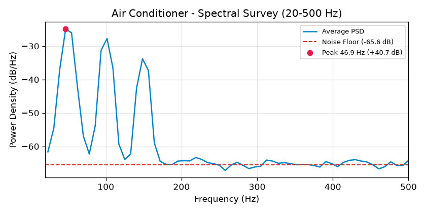
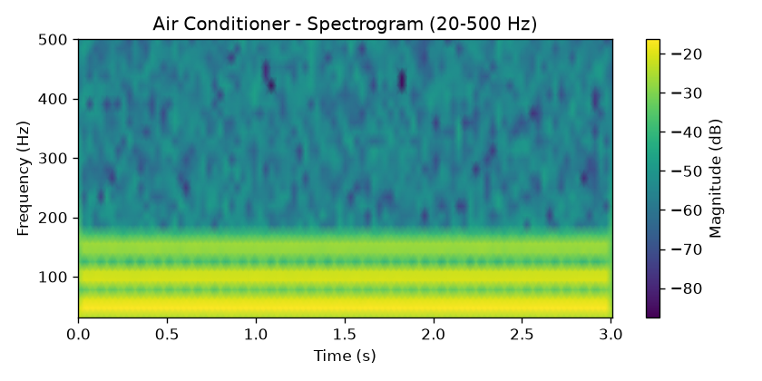
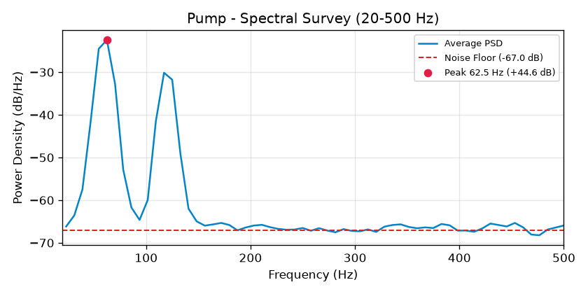
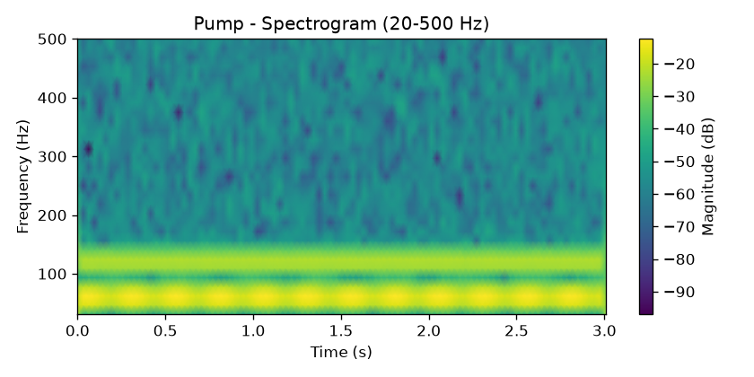
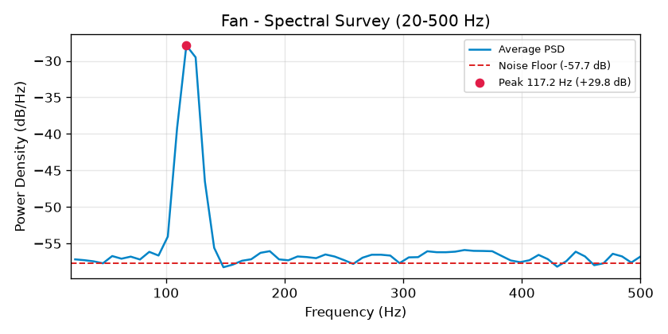
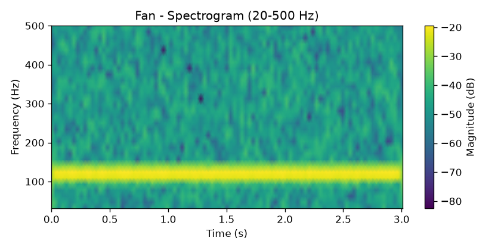
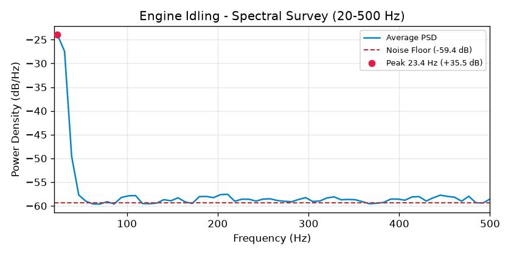
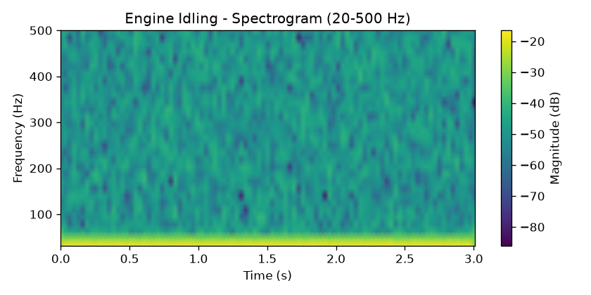

# Spectral Survey Report (20–500 Hz)

Survey of appliance acoustic hum frequencies, harmonic series, and observable SNR above ambient noise floor.

## Summary Table of Detectable Bands

| Appliance Source | Peak Frequency (Hz) | Prominence above Noise (dB) | Harmonic Family | Usable Band Range | Audio Clips |
|---|---|---|---|---|---|
| air_conditioner | 46.9 Hz | +40.7 dB | 50 Hz mains | 37-57 Hz | 1 |
| pump | 62.5 Hz | +44.6 dB | 60 Hz mains | 52-72 Hz | 1 |
| fan | 117.2 Hz | +29.8 dB | 60 Hz mains | 107-127 Hz | 1 |
| engine_idling | 23.4 Hz | +35.5 dB | Mechanical / Rotor | 20-33 Hz | 1 |

## Generated Visualizations

### Air Conditioner
- **PSD Plot**: 
- **Spectrogram**: 

### Pump
- **PSD Plot**: 
- **Spectrogram**: 

### Fan
- **PSD Plot**: 
- **Spectrogram**: 

### Engine Idling
- **PSD Plot**: 
- **Spectrogram**: 

